# Gadgets inspiration: posts Oscar keeps saving

Built 27 Nov 2026 from Oscar's X likes and bookmarks, and from the posts shared in his X Chat. Read-only: nothing was posted, liked, bookmarked or sent. Internal. Sender names in the Source lines are for Oscar's reference only; the pitch deck must not name anyone.

Source list with dates and coverage limits: `/workspace/gadgets/x-gadget-posts-2026-11-27.md` (box). 29 posts: 18 from likes and bookmarks, 11 found only in the chat. Dates are 2026, Europe/Madrid, the date the post was created (likes, bookmarks) or shared (chat). Oscar's comments are quoted as written, typos included.

Images: 29 of 29. Each is the first photo of the post, or the first frame of its video, resized to 900 px on the long side. All images belong to their authors; they are here as private reference, not for publication.

## Displays and e-ink

### @hturan

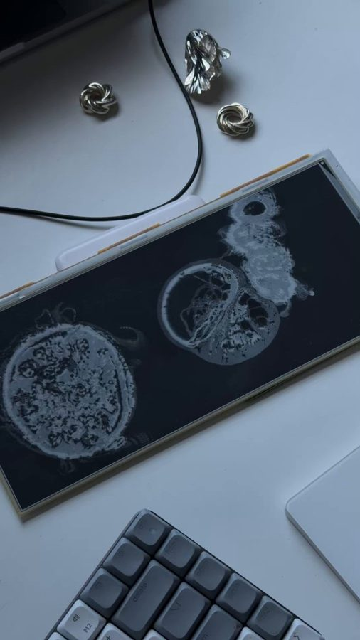

- What: Artificial-life simulation on a 60 Hz e-ink display; the ghosting and trails give fluid-looking motion. Image is the video's first frame.
- Link: https://x.com/hturan/status/2125609297895903294
- Source: DM, sent by Fionn, 25 Nov 2026

## Desk gadgets

### @andreintg

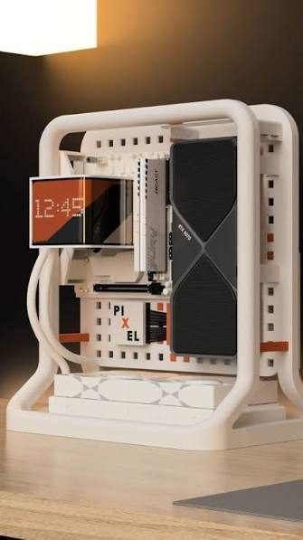

- What: Pixel, an open-frame 3D-printed PC case, called gorgeous by the author.
- Link: https://x.com/andreintg/status/2125946257852285039
- Source: like; DM, sent by Oscar, 26 Nov 2026
- Comment: "Another example all of these are made for tech Brose the market of the people is wide-open"

### @kieranklaassen

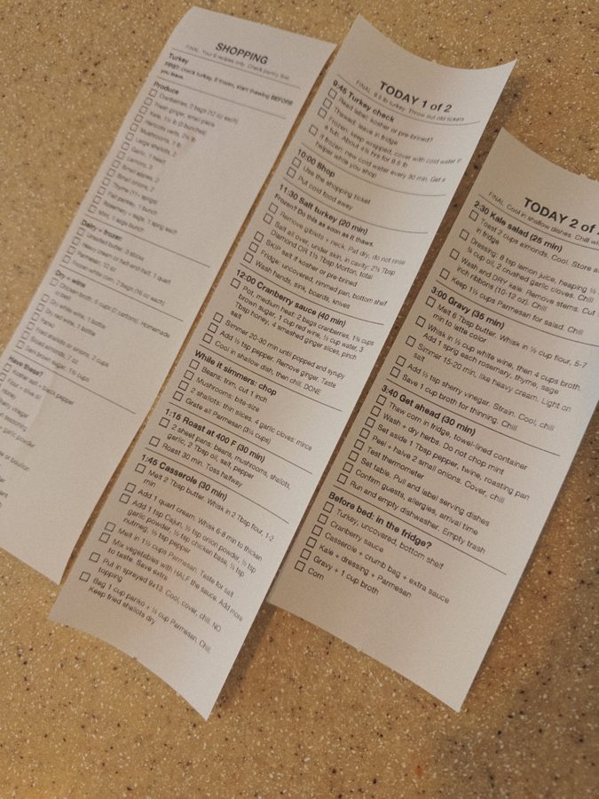

- What: LLMs used with thermal printers for planning; the photo shows printed paper slips.
- Link: https://x.com/kieranklaassen/status/2125649169138528553
- Source: DM, sent by Oscar, 26 Nov 2026
- Comment: "gadjet #45"

### @inanimate_tech

- What: WORKS '26: five promptable AI devices you can order, controlled by gesture and voice. Image is the video's first frame.
- Link: https://x.com/inanimate_tech/status/2125257053341966427
- Source: DM, sent by Fionn, 25 Nov 2026
- Comment: Comment from Fionn: Bro what about some ting like this for you e ink stuff

### @oliviscusAI

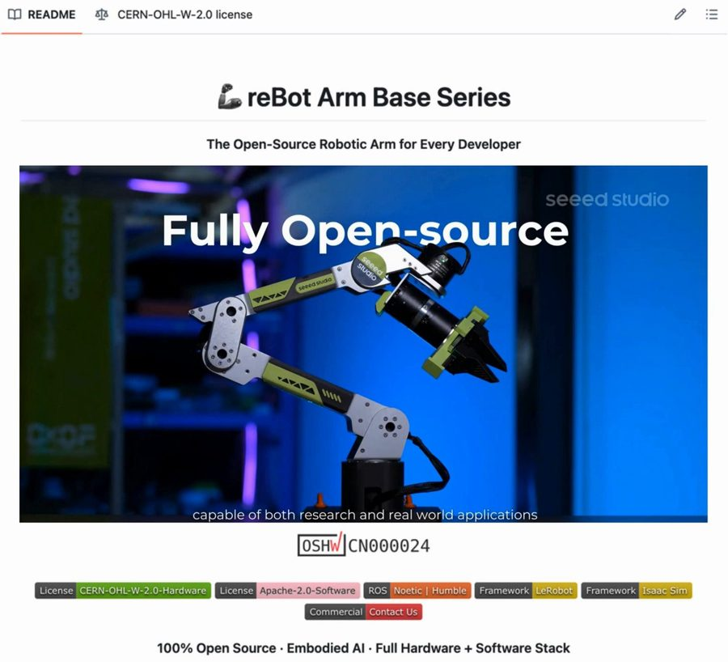

- What: reBot-DevArm from Seeed Studio, an open-source robotic arm you can legally build and sell. Image is the video's first frame.
- Link: https://x.com/oliviscusAI/status/2122686374998655392
- Source: like, 17 Nov 2026

### @RaemondBW

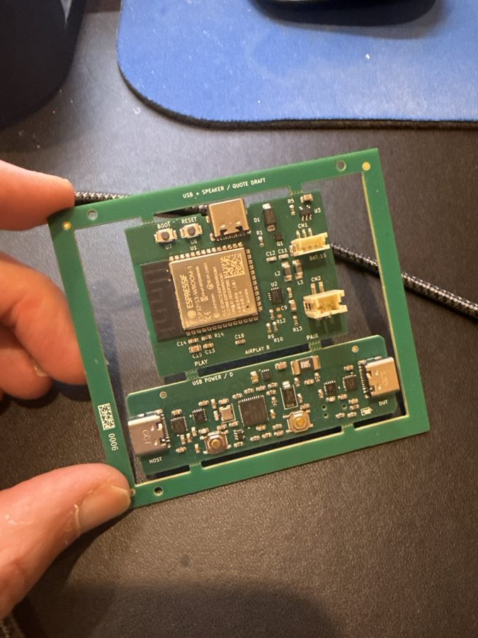

- What: Two hardware projects: a USB power analyzer, and a replacement PCB that adds AirPlay to an IKEA speaker. Image shows the PCB.
- Link: https://x.com/RaemondBW/status/2117773168807166443
- Source: DM, sent by Fionn, 4 Nov 2026

### @luusssso

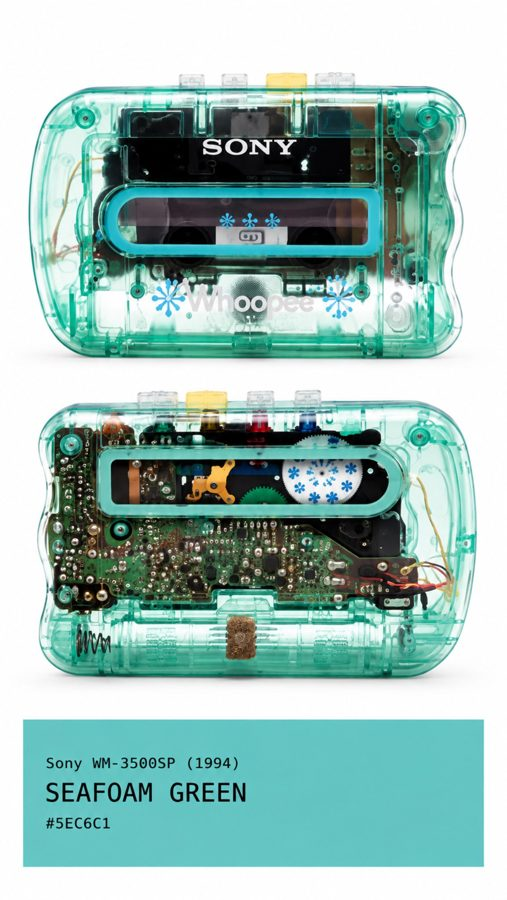

- What: Y2K transparent consumer tech (a see-through Sony device in sea green), called "so peak" by the author.
- Link: https://x.com/luusssso/status/2113274039297028534
- Source: like and bookmark, 22 Oct 2026

## Wall and decor pieces

### @pmamtraveller

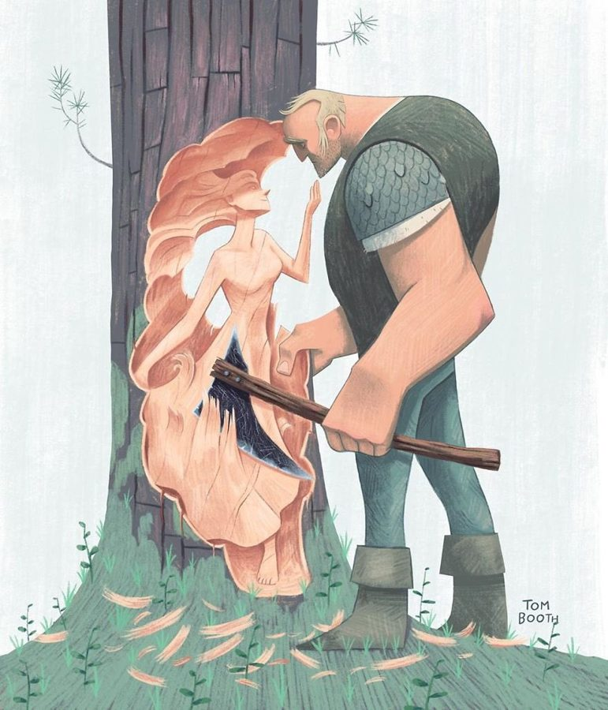

- What: Tom Booth illustrations from the woodcutter series: a man carving the same woman's likeness as he ages.
- Link: https://x.com/pmamtraveller/status/2124808965351682185
- Source: like, 23 Nov 2026

### @pmamtraveller

- What: "His Grace" by Natalia Tolmacheva.
- Link: https://x.com/pmamtraveller/status/2124365500000153752
- Source: like, 22 Nov 2026

### @Denismourir1000

- What: Antique European art and illustrations.
- Link: https://x.com/Denismourir1000/status/2124263578261700815
- Source: like and bookmark, 21 Nov 2026

### @pmamtraveller

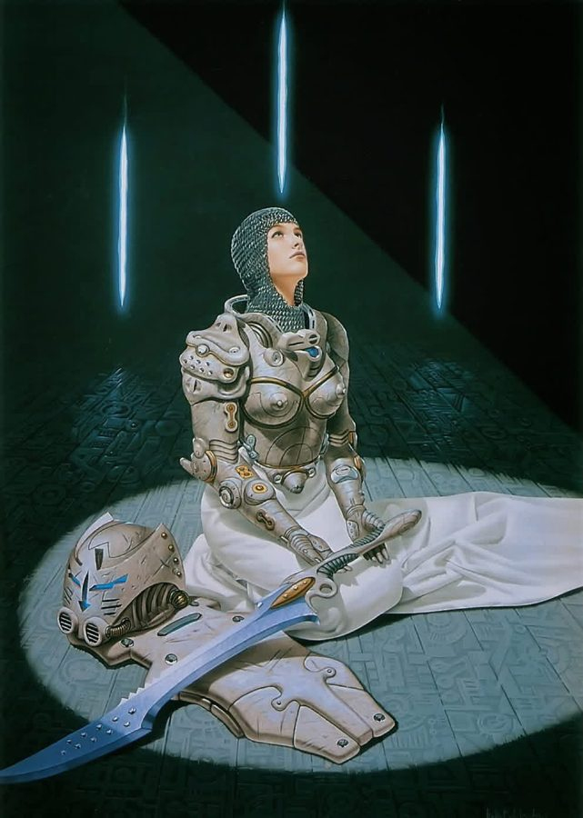

- What: "Chevaliere (Female Knight)", a 2004 painting by French hyperrealist Hubert de Lartigue.
- Link: https://x.com/pmamtraveller/status/2121998102206754958
- Source: like, 15 Nov 2026

### @_GVNTHER_

- What: Illustrations by Yoshitaka Amano.
- Link: https://x.com/_GVNTHER_/status/2111851254091776122
- Source: like, 18 Oct 2026

## Furniture

### @modem_works

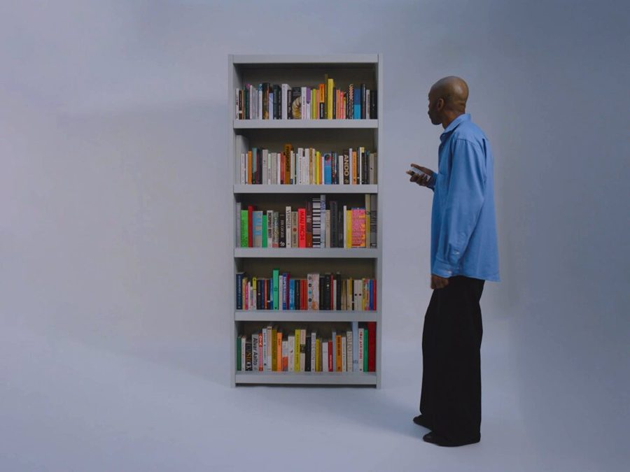

- What: Oracle Shelf, an "intelligent bookcase" that spots book spines and lights up the books that answer a spoken question. Image is the video's first frame.
- Link: https://x.com/modem_works/status/2125588103276720393
- Source: DM, sent by Oscar, 25 Nov 2026
- Comment: "it's litearlly the game, buy some cheapass hardware from china and add a vibecoded app, ppl will buy uit"

### @yitong

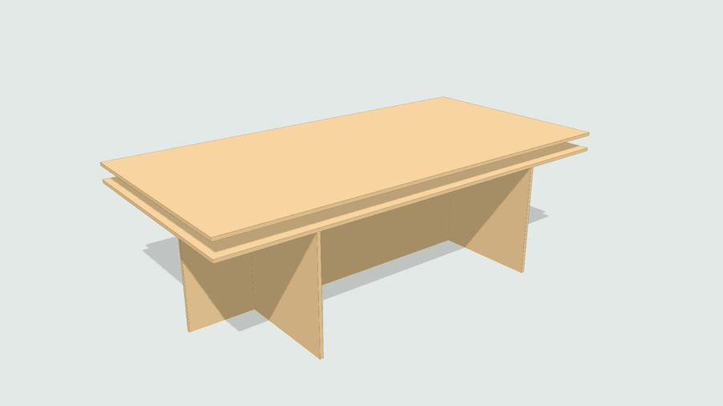

- What: Furniture-making tip: turn a design into a CNC-ready file for a local shop, shown on a Donald Judd-style table in Baltic birch. Image is the video's first frame.
- Link: https://x.com/yitong/status/2116952646406041615
- Source: DM, sent by Fionn, 2 Nov 2026

## Art objects

### @pmamtraveller

- What: "Each Bird Needs Freedom", a doll made around 2013 by Lithuanian dollmaker Dorote Zaukaite.
- Link: https://x.com/pmamtraveller/status/2124080717508587904
- Source: like, 21 Nov 2026

### @pmamtraveller

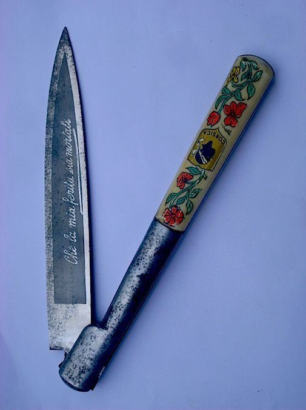

- What: Corsican vendetta knife with floral detail on the handle.
- Link: https://x.com/pmamtraveller/status/2124079010317508699
- Source: like, 21 Nov 2026

### @pmamtraveller

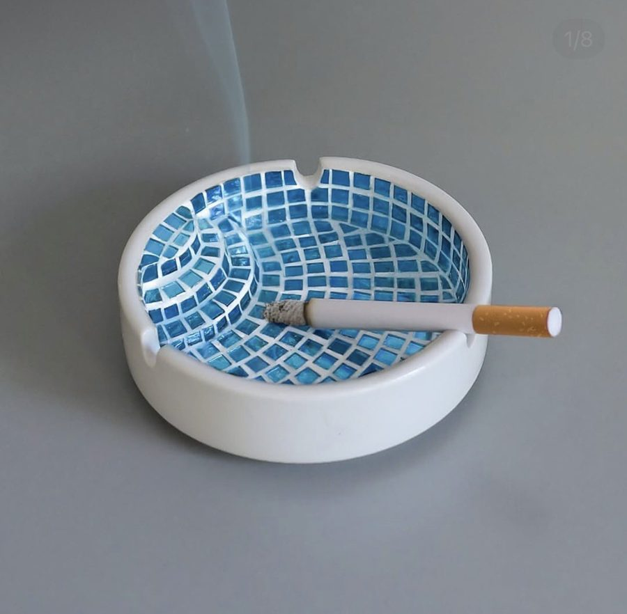

- What: Ceramic pieces designed by artist Gab Bois (an ashtray with blue mosaic tiles in the photo).
- Link: https://x.com/pmamtraveller/status/2123854155856880066
- Source: like; DM, sent by Oscar, 20 Nov 2026
- Comment: "Man I love ceramics"

### @wana_visualss

- What: Statue of Queen Zenobia in the Mediterranean Sea, Latakia, Syria.
- Link: https://x.com/wana_visualss/status/2123544537419194476
- Source: like, 19 Nov 2026

### @pmamtraveller

- What: Bronze sculptures by Scottish sculptor Philip Jackson: cloaked figures in wide hats or hoods with small gilded masks.
- Link: https://x.com/pmamtraveller/status/2122938259906994637
- Source: like, 18 Nov 2026

### @pmamtraveller

- What: "Le Roi (The King)" by sculptor Arsen Avetissian.
- Link: https://x.com/pmamtraveller/status/2121669740770849167
- Source: like and bookmark, 14 Nov 2026

### @artinsociety

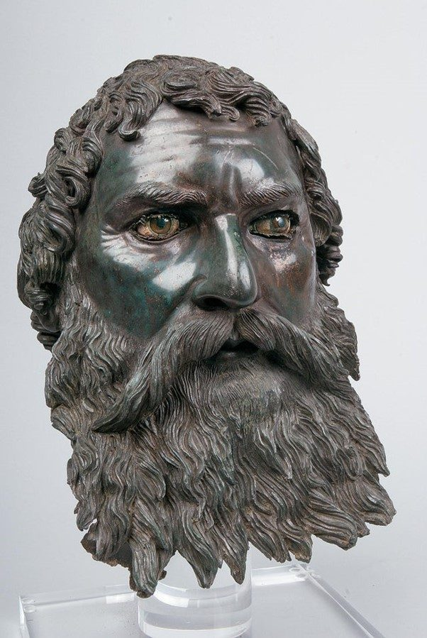

- What: 2,300-year-old bronze head of Thracian king Seuthes III with alabaster and glass-paste eyes (National Museum of Archaeology, Sofia).
- Link: https://x.com/artinsociety/status/2119704977648365754
- Source: like, 9 Nov 2026

### @g3p_graph

- What: Prototype hand-armor accessory worn over bare hands or thin gloves. Image is the video's first frame.
- Link: https://x.com/g3p_graph/status/2113587717259075882
- Source: DM, sent by Oscar, 24 Oct 2026
- Comment: "His typa shit but for robots that could fit anyone"

## Lighting

None found. Observation: nothing about lighting appears in the likes, bookmarks or chat.

## Other

### @womp3D

- What: Unusual 3D printing, captioned "not your average 3d printing" (a black printed bowl in the photo). Image is the video's first frame.
- Link: https://x.com/womp3D/status/2125998015592726811
- Source: DM, sent by Oscar, 27 Nov 2026

### @SciFiArchives

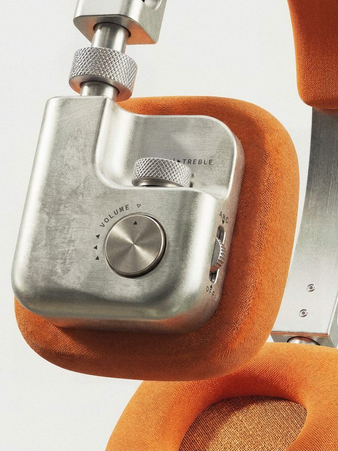

- What: TUNE X3 headphones by Pressec Design, a retrofuturistic concept inspired by vintage studio equipment.
- Link: https://x.com/SciFiArchives/status/2123010578616659969
- Source: DM, sent by Fionn, 18 Nov 2026
- Comment: Fionn: Gorgeous design. Oscar: like unironically bro

### @pmamtraveller

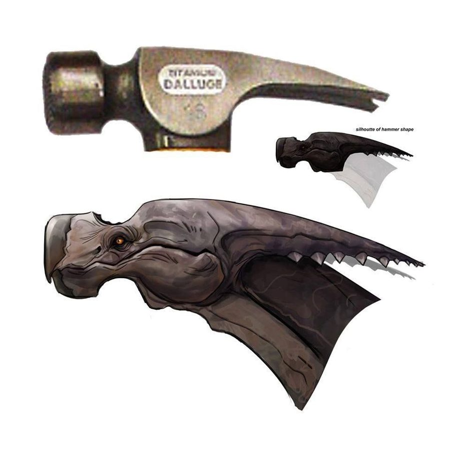

- What: Concept artworks by Safdar Ali Mirza: creature heads designed after axes and hand tools.
- Link: https://x.com/pmamtraveller/status/2122893427323056464
- Source: like, 18 Nov 2026

### @kevintwohy

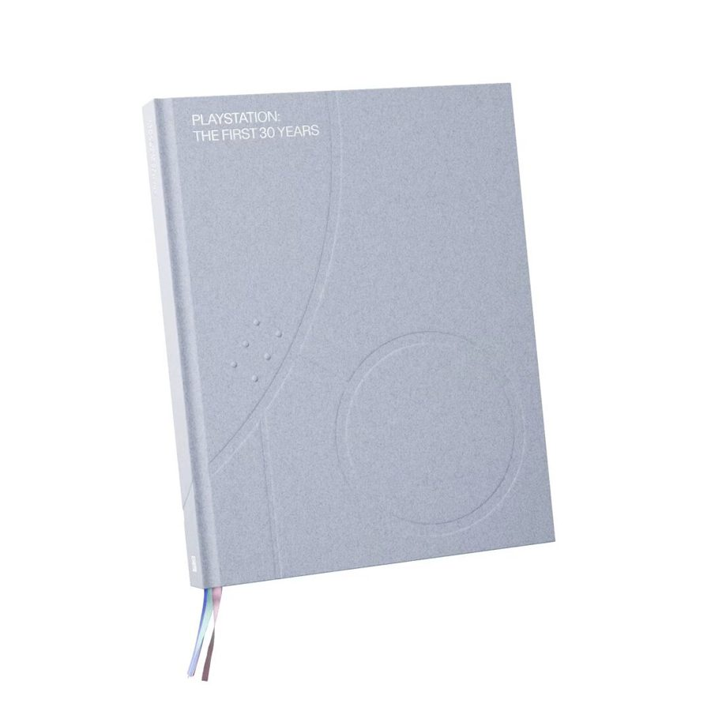

- What: Book on hardware prototyping and industrial and interaction design, showing the development of an iconic piece of consumer electronics. Image is a video frame or the book cover.
- Link: https://x.com/kevintwohy/status/2121739170221789433
- Source: like; DM, sent by Fionn, 14 Nov 2026

### @MaxLobovsky

- What: Vibe-designed water gun with transparent resin parts and printed elastomer valves and seals, made on a $700 printer. The image comes from the quoted original post (an AI-modeled water blaster in a printer), because this post itself had no media. Image is the video's first frame.
- Link: https://x.com/MaxLobovsky/status/2121458552803914203
- Source: DM, sent by Fionn, 14 Nov 2026

### @guilhemlettron

- What: Programmable drone you can put together for under 20 euros.
- Link: https://x.com/guilhemlettron/status/2114750542941442453
- Source: DM, sent by Fionn, 27 Oct 2026

### @asimovinc

- What: Asimov 1, an open-source reference humanoid robot sold as a complete DIY kit for $20,000.
- Link: https://x.com/asimovinc/status/2087040759140855981
- Source: bookmark, 11 Aug 2026

## Patterns Oscar keeps saving

Observation from these 29 posts, not a measurement and not a forecast. Each pattern lists the posts it rests on.

- **Cheap hardware plus an app.** Oscar's own words on the Oracle Shelf: "buy some cheapass hardware from china and add a vibecoded app, ppl will buy uit". Same direction in the drone under 20 euros, the open-source robot arm, the AirPlay PCB for an IKEA speaker, and the thermal-printer-plus-LLM post ("gadjet #45").
- **Transparent and retrofuturistic objects.** The Y2K see-through Sony device (like and bookmark), the transparent-resin water gun, the TUNE X3 headphones (Oscar: "like unironically bro") and the open-frame Pixel PC case all show internals or vintage studio-equipment looks.
- **E-ink and calm screens.** One post is saved directly (the 60 Hz e-ink simulation) and one chat comment links AI devices to "you e ink stuff". Observation only: this is a thin signal, 1 or 2 posts.
- **Ceramics and hand-made objects.** The one material Oscar says he loves outright is ceramics ("Man I love ceramics", Gab Bois). The Art objects and Wall and decor groups (13 of 29 posts, 9 of them from @pmamtraveller) lean to sculpture, dolls, bronze and illustration rather than product design.
- **Objects with a built-in behaviour.** Oracle Shelf (a bookcase that lights up the answer), the AI-designed water gun, the printed-paper planning post and the AirPlay speaker PCB all add one small smart function to an ordinary object.
- **AI-assisted making.** The water gun modeled by Claude, the CNC-ready table file, the LLM with a thermal printer and "vibecoded app" appear in 4 posts and in Oscar's comments.
- **Made for a wide market, not only for tech people.** Oscar on the Pixel case: "all of these are made for tech Brose the market of the people is wide-open"; on the hand armor: "for robots that could fit anyone".
- **Gap.** No lighting post was found in likes, bookmarks or the chat. It is a gap in the saved material, not a statement about demand.

## How the images were fetched

Post media came from X's public read tools (get_posts_by_ids with media fields), then downloaded from pbs.twimg.com. No image was skipped; the water-gun post had no media of its own, so its image comes from the post it quotes.

## Added 27 Nov evening (sent by Oscar)

### @huntie
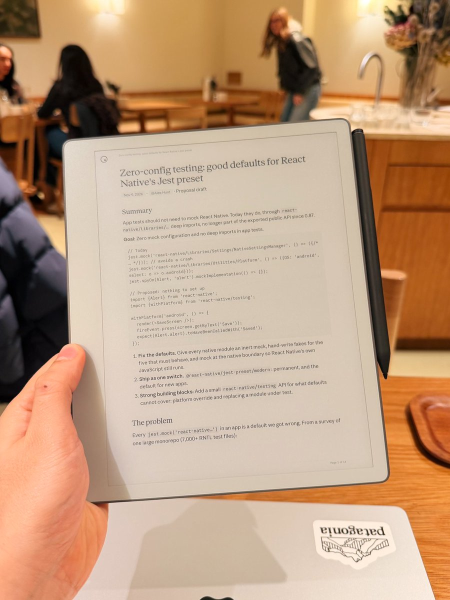
- What: "My favourite way to review agent plans", a coffee-desk setup for reviewing AI agent plans.
- Link: https://x.com/huntie/status/2126278478295109862
- Source: Oscar in Innovator chat, 27 Nov 2026

### @ahm3dhub

- What: ESP-Mosaico ESP32-S31 modular AI board with a 2.16in touch AMOLED, IMU and voice, sold on AliExpress. A cheap China-sourced base for a premium gadget.
- Link: https://x.com/ahm3dhub/status/2126078769483985199
- Source: Oscar in Innovator chat, 27 Nov 2026

