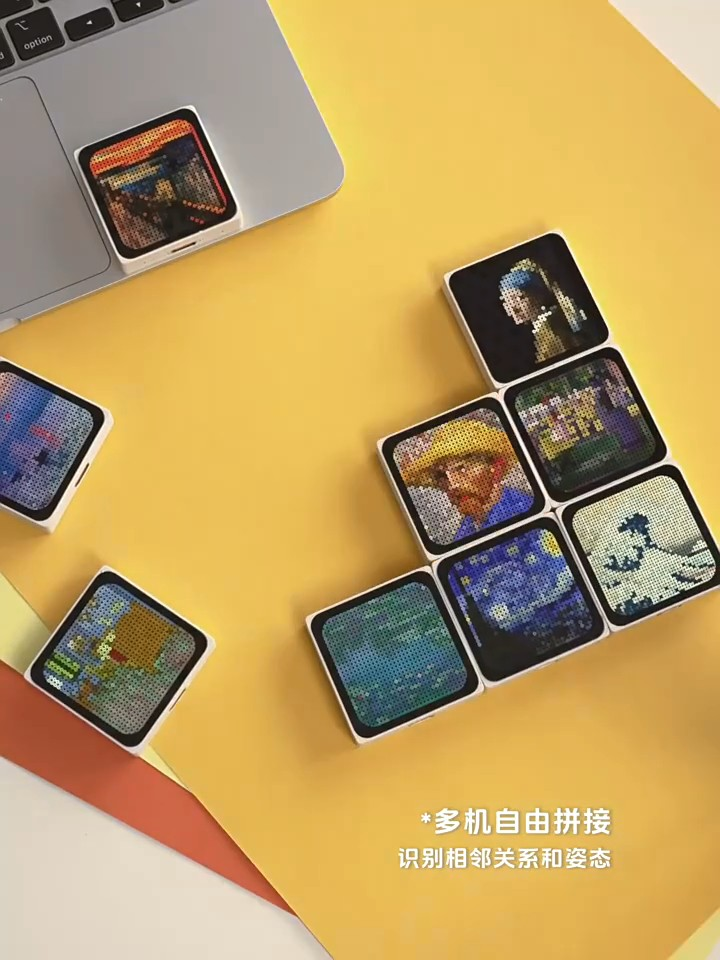
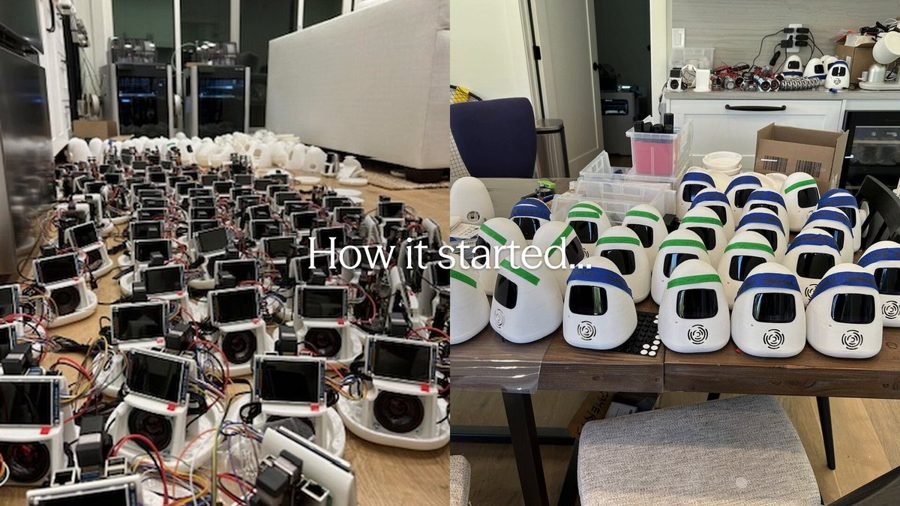
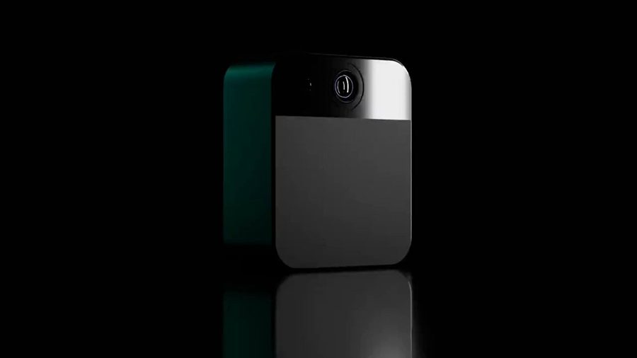
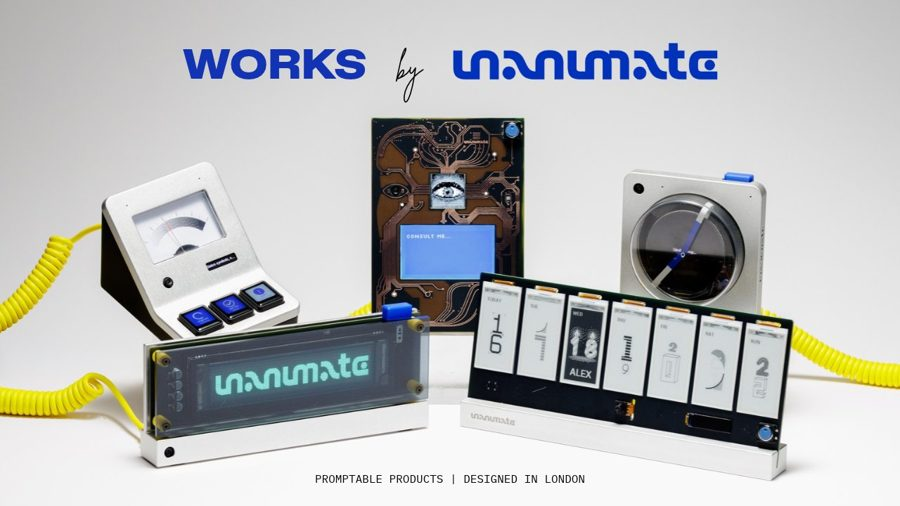
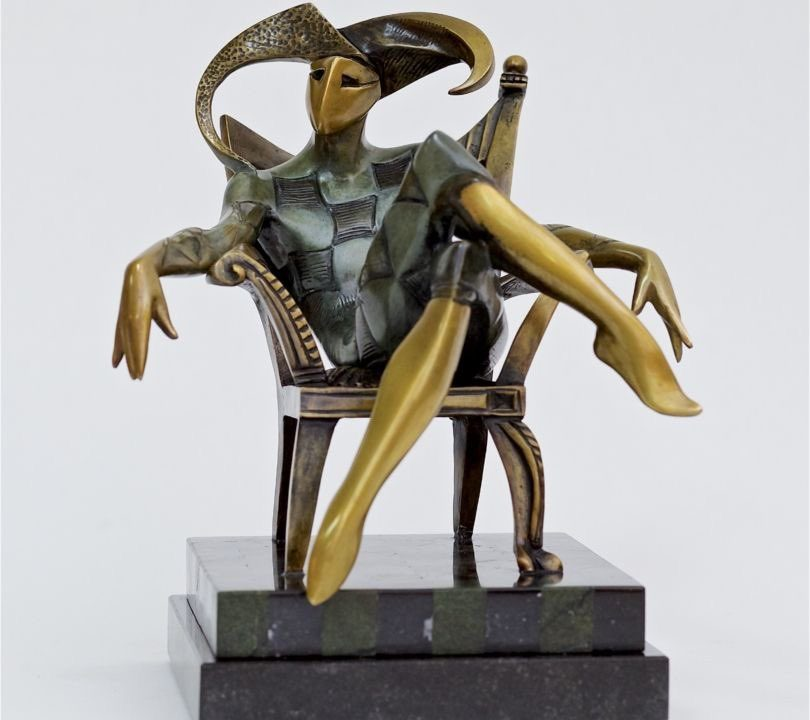
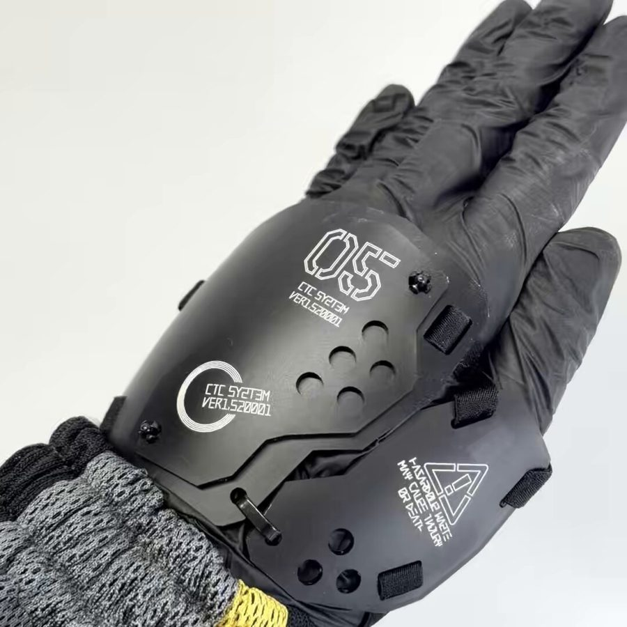
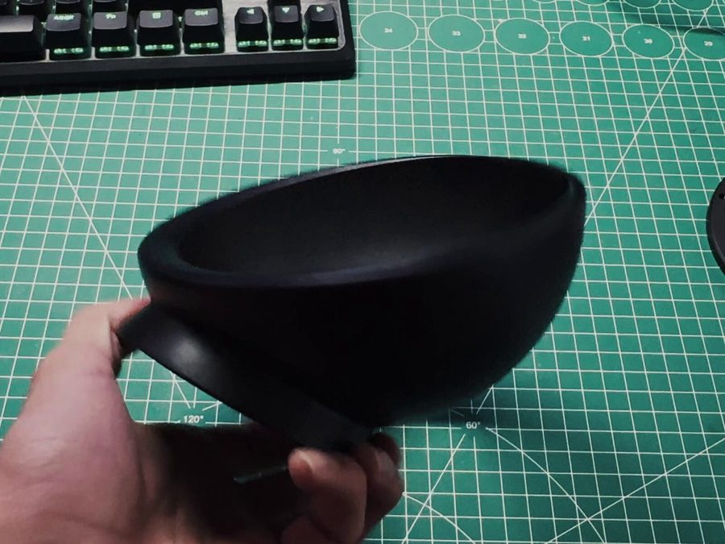
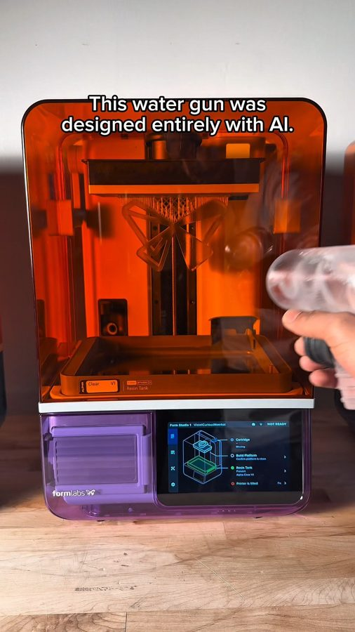
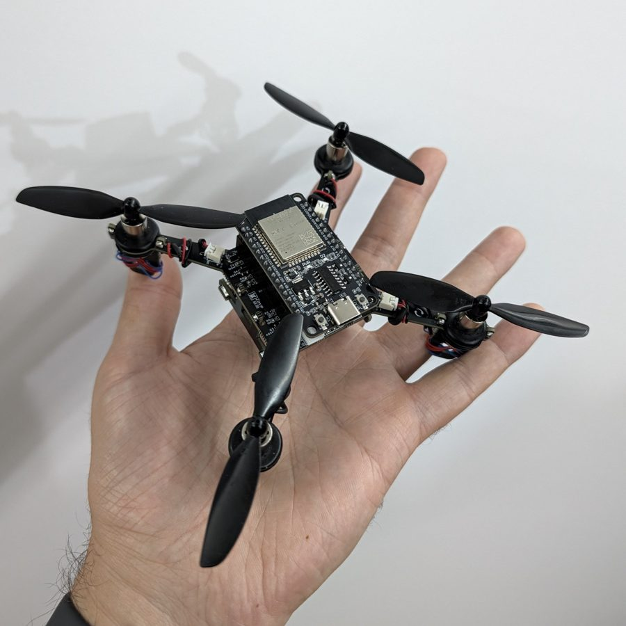

# Gadgets inspiration: posts Oscar keeps saving

Built 27 Nov 2026 from Oscar's X likes and bookmarks, and from the posts shared in his X Chat. Updated 28 Nov 2026 with two posts Oscar sent on the evening of 27 Nov. Read-only: nothing was posted, liked, bookmarked or sent. Internal. Sender names in the Source lines are for Oscar's reference only; the pitch deck must not name anyone.

Source list with dates and coverage limits: `/workspace/gadgets/x-gadget-posts-2026-11-27.md` (box), plus the posts Oscar sent on 27 Nov and 28 Nov. 28 posts: 13 from likes and bookmarks, 11 found only in the chat, 4 sent by Oscar (2 on 27 Nov, 2 on 28 Nov). Five wall and decor posts, all from likes or bookmarks, were dropped on 28 Nov at Oscar's request. Dates are 2026, Europe/Madrid, the date the post was created (likes, bookmarks) or shared (chat or Innovator chat). Oscar's comments are quoted as written, typos included.

Images: 28 of 28. Each is the first photo of the post, or the first frame of its video, resized to 900 px on the long side. All images belong to their authors; they are here as private reference, not for publication.

## Displays and e-ink

### @huntie

- What: A large e-ink tablet with a stylus, held in a cafe, showing a written plan with handwritten notes. The author captions it "My favourite way to review agent plans" with a coffee emoji. First of two similar photos.
- Link: https://x.com/huntie/status/2126278478295109862
- Source: sent by Oscar in the Innovator chat, 27 Nov 2026

### @ahm3dhub

- What: ESP-Mosaico ESP32-S31 modular AI board with a 2.16in touch AMOLED, IMU and voice, sold on AliExpress and made in Mainland China. The image is the video's first frame: square AMOLED tiles showing pixel-art paintings, designed to snap together.
- Link: https://x.com/ahm3dhub/status/2126078769483985199
- Source: sent by Oscar in the Innovator chat, 27 Nov 2026

### @hturan

- What: Artificial-life simulation on a 60 Hz e-ink display; the ghosting and trails give fluid-looking motion. Image is the video's first frame.
- Link: https://x.com/hturan/status/2125609297895903294
- Source: DM, sent by Fionn, 25 Nov 2026

## Desk gadgets

### @audrlo

- What: A split frame captioned "How it started...": early 3D-printed robot-head prototypes with exposed screens and wiring on the left, and finished white production units with small screens and coloured bands on the right. The author writes that they began as 18-year-olds with a 3D printer and now ship a production-grade device to families across the US. Image is the video's first frame (the post's own video, not the quoted one).
- Link: https://x.com/audrlo/status/2126500872079524186
- Source: sent by Oscar in the Innovator chat, 28 Nov 2026

### @kinglycrow

- What: The Scout, a magnetic Wi-Fi camera listed at $25 in the post, "gives your agent eyes at home" (fridge, pantry, door, pets), no subscription. Image is the video's first frame: a small square camera with a dark body and a glossy lens plate.
- Link: https://x.com/kinglycrow/status/2126374876135231971
- Source: sent by Oscar in the Innovator chat, 28 Nov 2026

### @andreintg

- What: Pixel, an open-frame 3D-printed PC case, called gorgeous by the author.
- Link: https://x.com/andreintg/status/2125946257852285039
- Source: like; DM, sent by Oscar, 26 Nov 2026
- Comment: "Another example all of these are made for tech Brose the market of the people is wide-open"

### @kieranklaassen

- What: LLMs used with thermal printers for planning; the photo shows printed paper slips.
- Link: https://x.com/kieranklaassen/status/2125649169138528553
- Source: DM, sent by Oscar, 26 Nov 2026
- Comment: "gadjet #45"

### @inanimate_tech

- What: WORKS '26: five promptable AI devices you can order, controlled by gesture and voice. Image is the video's first frame.
- Link: https://x.com/inanimate_tech/status/2125257053341966427
- Source: DM, sent by Fionn, 25 Nov 2026
- Comment: Comment from Fionn: Bro what about some ting like this for you e ink stuff

### @oliviscusAI

- What: reBot-DevArm from Seeed Studio, an open-source robotic arm you can legally build and sell. Image is the video's first frame.
- Link: https://x.com/oliviscusAI/status/2122686374998655392
- Source: like, 17 Nov 2026

### @RaemondBW

- What: Two hardware projects: a USB power analyzer, and a replacement PCB that adds AirPlay to an IKEA speaker. Image shows the PCB.
- Link: https://x.com/RaemondBW/status/2117773168807166443
- Source: DM, sent by Fionn, 4 Nov 2026

### @luusssso

- What: Y2K transparent consumer tech (a see-through Sony device in sea green), called "so peak" by the author.
- Link: https://x.com/luusssso/status/2113274039297028534
- Source: like and bookmark, 22 Oct 2026

## Furniture

### @modem_works

- What: Oracle Shelf, an "intelligent bookcase" that spots book spines and lights up the books that answer a spoken question. Image is the video's first frame.
- Link: https://x.com/modem_works/status/2125588103276720393
- Source: DM, sent by Oscar, 25 Nov 2026
- Comment: "it's litearlly the game, buy some cheapass hardware from china and add a vibecoded app, ppl will buy uit"

### @yitong

- What: Furniture-making tip: turn a design into a CNC-ready file for a local shop, shown on a Donald Judd-style table in Baltic birch. Image is the video's first frame.
- Link: https://x.com/yitong/status/2116952646406041615
- Source: DM, sent by Fionn, 2 Nov 2026

## Art objects

### @pmamtraveller

- What: "Each Bird Needs Freedom", a doll made around 2013 by Lithuanian dollmaker Dorote Zaukaite.
- Link: https://x.com/pmamtraveller/status/2124080717508587904
- Source: like, 21 Nov 2026

### @pmamtraveller

- What: Corsican vendetta knife with floral detail on the handle.
- Link: https://x.com/pmamtraveller/status/2124079010317508699
- Source: like, 21 Nov 2026

### @pmamtraveller

- What: Ceramic pieces designed by artist Gab Bois (an ashtray with blue mosaic tiles in the photo).
- Link: https://x.com/pmamtraveller/status/2123854155856880066
- Source: like; DM, sent by Oscar, 20 Nov 2026
- Comment: "Man I love ceramics"

### @wana_visualss

- What: Statue of Queen Zenobia in the Mediterranean Sea, Latakia, Syria.
- Link: https://x.com/wana_visualss/status/2123544537419194476
- Source: like, 19 Nov 2026

### @pmamtraveller

- What: Bronze sculptures by Scottish sculptor Philip Jackson: cloaked figures in wide hats or hoods with small gilded masks.
- Link: https://x.com/pmamtraveller/status/2122938259906994637
- Source: like, 18 Nov 2026

### @pmamtraveller

- What: "Le Roi (The King)" by sculptor Arsen Avetissian.
- Link: https://x.com/pmamtraveller/status/2121669740770849167
- Source: like and bookmark, 14 Nov 2026

### @artinsociety

- What: 2,300-year-old bronze head of Thracian king Seuthes III with alabaster and glass-paste eyes (National Museum of Archaeology, Sofia).
- Link: https://x.com/artinsociety/status/2119704977648365754
- Source: like, 9 Nov 2026

### @g3p_graph

- What: Prototype hand-armor accessory worn over bare hands or thin gloves. Image is the video's first frame.
- Link: https://x.com/g3p_graph/status/2113587717259075882
- Source: DM, sent by Oscar, 24 Oct 2026
- Comment: "His typa shit but for robots that could fit anyone"

## Lighting

None found. Observation: nothing about lighting appears in the likes, bookmarks or chat.

## Other

### @womp3D

- What: Unusual 3D printing, captioned "not your average 3d printing" (a black printed bowl in the photo). Image is the video's first frame.
- Link: https://x.com/womp3D/status/2125998015592726811
- Source: DM, sent by Oscar, 27 Nov 2026

### @SciFiArchives

- What: TUNE X3 headphones by Pressec Design, a retrofuturistic concept inspired by vintage studio equipment.
- Link: https://x.com/SciFiArchives/status/2123010578616659969
- Source: DM, sent by Fionn, 18 Nov 2026
- Comment: Fionn: Gorgeous design. Oscar: like unironically bro

### @pmamtraveller

- What: Concept artworks by Safdar Ali Mirza: creature heads designed after axes and hand tools.
- Link: https://x.com/pmamtraveller/status/2122893427323056464
- Source: like, 18 Nov 2026

### @kevintwohy

- What: Book on hardware prototyping and industrial and interaction design, showing the development of an iconic piece of consumer electronics. Image is a video frame or the book cover.
- Link: https://x.com/kevintwohy/status/2121739170221789433
- Source: like; DM, sent by Fionn, 14 Nov 2026

### @MaxLobovsky

- What: Vibe-designed water gun with transparent resin parts and printed elastomer valves and seals, made on a $700 printer. The image comes from the quoted original post (an AI-modeled water blaster in a printer), because this post itself had no media. Image is the video's first frame.
- Link: https://x.com/MaxLobovsky/status/2121458552803914203
- Source: DM, sent by Fionn, 14 Nov 2026

### @guilhemlettron

- What: Programmable drone you can put together for under 20 euros.
- Link: https://x.com/guilhemlettron/status/2114750542941442453
- Source: DM, sent by Fionn, 27 Oct 2026

### @asimovinc

- What: Asimov 1, an open-source reference humanoid robot sold as a complete DIY kit for $20,000.
- Link: https://x.com/asimovinc/status/2087040759140855981
- Source: bookmark, 11 Aug 2026

## Patterns Oscar keeps saving

Observation from these 28 posts, not a measurement and not a forecast. Each pattern lists the posts it rests on.

- **Cheap hardware plus an app.** Oscar's own words on the Oracle Shelf: "buy some cheapass hardware from china and add a vibecoded app, ppl will buy uit". Same direction in the drone under 20 euros, the open-source robot arm, the AirPlay PCB for an IKEA speaker, the thermal-printer-plus-LLM post ("gadjet #45"), the ESP32-S31 modular AMOLED board sold on AliExpress and made in Mainland China, and The Scout, a magnetic Wi-Fi camera listed at $25.
- **Transparent and retrofuturistic objects.** The Y2K see-through Sony device (like and bookmark), the transparent-resin water gun, the TUNE X3 headphones (Oscar: "like unironically bro") and the open-frame Pixel PC case all show internals or vintage studio-equipment looks.
- **E-ink and calm screens.** Two posts show e-ink or paper-like screens directly: the 60 Hz e-ink simulation, and the large e-ink tablet used in a cafe to review a written plan. One earlier chat comment also links AI devices to "you e ink stuff".
- **Ceramics and hand-made objects.** The one material Oscar says he loves outright is ceramics ("Man I love ceramics", Gab Bois). The Art objects group (8 of 28 posts, 5 of them from @pmamtraveller) leans to sculpture, dolls, bronze and illustration rather than product design.
- **Objects with a built-in behaviour.** Oracle Shelf (a bookcase that lights up the answer), the AI-designed water gun, the printed-paper planning post and the AirPlay speaker PCB all add one small smart function to an ordinary object.
- **AI-assisted making.** The water gun modeled by Claude, the CNC-ready table file, the LLM with a thermal printer and "vibecoded app" appear in 4 posts and in Oscar's comments.
- **Made for a wide market, not only for tech people.** Oscar on the Pixel case: "all of these are made for tech Brose the market of the people is wide-open"; on the hand armor: "for robots that could fit anyone". The @audrlo post shows a 3D-printed prototype grown into a production device now shipping to families across the US.
- **Gap.** No lighting post was found in likes, bookmarks or the chat. It is a gap in the saved material, not a statement about demand.

## How the images were fetched

Post media came from X's public read tools (get_posts_by_ids with media fields), then downloaded from pbs.twimg.com. No image was skipped; the water-gun post had no media of its own, so its image comes from the post it quotes. The posts added on 28 Nov were fetched the same way (first photo, or the video preview for the ESP32 board, The Scout, and the @audrlo production-robot post).

